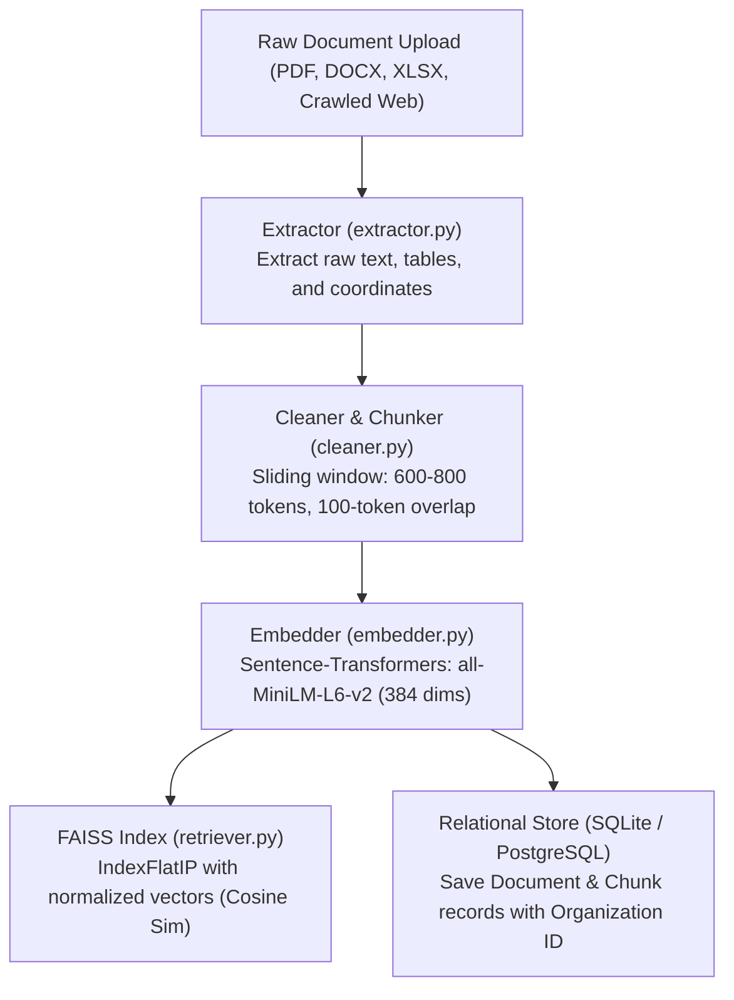
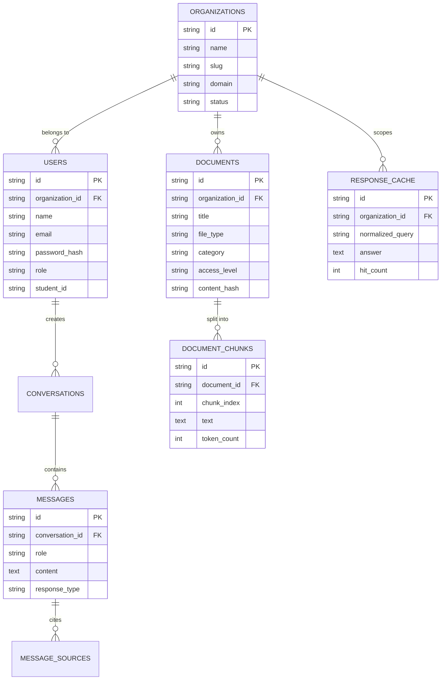
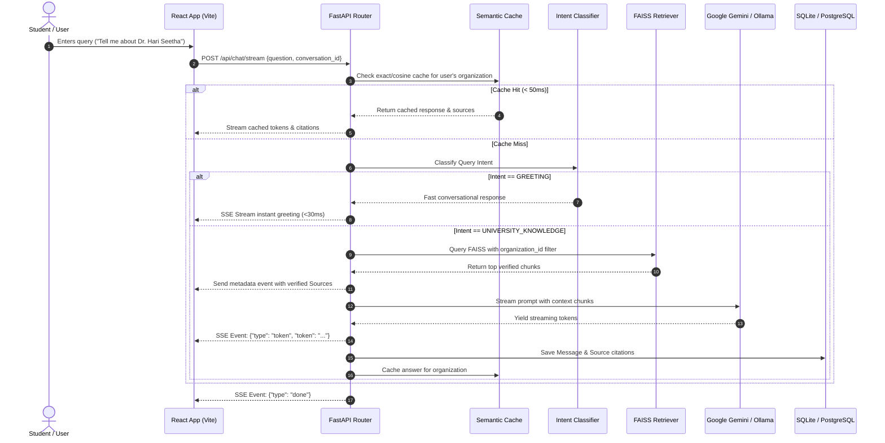

# Comprehensive Project Review & Viva Defense Guide
## AI-Powered Enterprise Multi-Tenant Knowledge Assistance Platform (Campus AI Copilot)

> **Document Version:** Final Review & Defense Edition  
> **Prepared for:** Final Capstone Evaluation & Project Panel Review  
> **Repository:** `AI-Powered-Enterprise-Knowledge-Assistance-Platform`  
> **Language & Tone:** Simple, Clear, Technical yet Conversational (Easy to Present & Explain)

---

## Quick Navigation Index
1. [Project Overview](#1-project-overview)
2. [The Core Problem](#2-the-core-problem)
3. [The Solution We Offer](#3-the-solution-we-offer)
4. [Target Audience & Stakeholders (Who Can Use This)](#4-target-audience--stakeholders)
5. [Complete Tools & Tech Stack](#5-complete-tools--tech-stack)
6. [Detailed Component Breakdown (Frontend & Backend)](#6-detailed-component-breakdown)
7. [Data Ingestion Pipeline & RAG Deep Dive](#7-data-ingestion-pipeline--rag-deep-dive)
8. [Database Architecture & Data Models](#8-database-architecture--data-models)
9. [Full System Architecture & Interaction Diagrams](#9-full-system-architecture--diagrams)
10. [End-to-End User & Data Workflows](#10-end-to-end-user--data-workflows)
11. [How Vector Indexing Works (FAISS Internals)](#11-how-vector-indexing-works-faiss-internals)
12. [External Dependencies & Third-Party Services](#12-external-dependencies--third-party-services)
13. [Future Scope & Production Roadmap](#13-future-scope--production-roadmap)
14. [Top 20 Panel Defense Questions & Winning Answers (Viva Q&A)](#14-top-20-panel-defense-questions--winning-answers)

---

# 1. Project Overview

The **Enterprise Multi-Tenant Knowledge Assistance Platform** (branded as **VIT-AP AI Copilot** / **SRM AP AI Copilot**) is an enterprise-grade, conversational intelligence system designed for higher education institutions and large organizations. 

Unlike public LLMs (like standard ChatGPT) that hallucinate, lack private institutional context, and have no awareness of campus bylaws, this system uses **Retrieval-Augmented Generation (RAG)** combined with **Deterministic Intent Routing** and **Strict Multi-Tenancy**.

### Key Highlights:
- **Zero-Hallucination Grounding:** Answers academic, syllabus, hostel, and administrative inquiries strictly based on official university documents (PDF, DOCX, XLSX, Web Crawls).
- **Multi-Tenancy with Strict Isolation:** Multiple institutions (e.g., VIT-AP, SRM AP) run securely on a single platform. Students and faculty only access their own organization’s knowledge base.
- **Dual-Engine Hybrid AI:** Operates with **Google Gemini (Cloud Primary - 1.5/2.0 Flash)** for lightning-fast cloud inference, and seamlessly falls back to **Ollama (`qwen2.5:1.5b`)** for 100% offline local privacy.
- **Enterprise Web Crawler:** Automated crawler that scans official university web domains with SSRF protection, deduplication, and scheduled incremental updates.
- **Sub-50ms Semantic Caching:** High-frequency student questions (e.g., *"Sunday outing timings"*, *"Hostel curfew"*) are resolved in under 50ms using vector-similarity response caching.

---

# 2. The Core Problem

Modern educational institutions face serious bottlenecks in knowledge distribution:

1. **Information Fragmentation:** Regulations, degree syllabi, faculty directories, and hostel rules are scattered across hundreds of PDFs, multi-sheet Excel files, portals (VTOP), and dynamic website links.
2. **Staff Overhead & Repeated Inquiries:** Administrative offices and Deans are overwhelmed every semester answering repetitive student queries regarding course credits, grade cutoffs, outing extensions, and cabin numbers.
3. **LLM Hallucinations:** Public AI assistants cannot be trusted by students because they invent false policies, mix regulations from different universities, and hallucinate course codes.
4. **Data Privacy & Single-Tenant Silos:** Building separate AI chatbots for each university is cost-prohibitive. However, naive multi-tenant chatbots risk leaking confidential documents across institutions.
5. **Slow Response Times & High API Costs:** Querying an LLM for every basic greeting or frequent question causes high API latency and unnecessary GPU or token costs.

---

# 3. The Solution We Offer

Our platform provides an end-to-end, multi-tenant solution with four breakthrough innovations:

```
+-----------------------------------------------------------------------------------+
|                           OUR 4-LAYER SOLUTION                                    |
+-------------------------+-------------------------+-------------------------------+
| 1. Dynamic Multi-Tenant | 2. Smart Intent Router  | 3. High-Precision RAG Engine  |
| Data Isolation          | Bypasses RAG for        | Dense chunking + FAISS cosine |
| Domain-based login maps | greetings; routes       | similarity + exact keyword    |
| users to isolated data. | queries deterministically| re-ranking & citations.      |
+-------------------------+-------------------------+-------------------------------+
| 4. Dual-Engine LLM & Semantic Vector Cache                                         |
| Ultra-fast sub-50ms cache + Gemini 1.5 Flash cloud / Ollama local offline engine. |
+-----------------------------------------------------------------------------------+
```

1. **Automated Domain-Based Tenancy:** When a student logs in with `@vitap.ac.in` or `@srm.ac.in`, the platform dynamically isolates vector search, UI branding, ground truth badges, and response context.
2. **Dual-Mode Conversational Flow:** 
   - Casual greetings (*"Hi"*, *"Good morning"*, *"Who are you?"*) are answered in **<30ms** without wasting vector search.
   - Institutional questions (*"What is Dr. Hari Seetha's cabin?"*, *"CSE Core Electives"*) trigger targeted vector retrieval with exact document and page citations.
3. **Exact Name & Program Precision:** Eliminates entity confusion by prioritizing chunks with exact faculty/course token matches.
4. **Interactive Explorer & Management:** Org Admins have a central `/org/knowledge` explorer to upload, inspect chunks, filter categories, and monitor vector ingestion health.

---

# 4. Target Audience & Stakeholders

| Stakeholder Role | Portal Access | What They Use It For |
| :--- | :--- | :--- |
| **Students** (`STUDENT`) | `/copilot` or `/chat` | Fast answers on academic bylaws, grading schemes, course prerequisites, hostel outing rules, faculty cabin locations, and generating formal email drafts to professors. |
| **Faculty & Staff** | `/copilot` | Instant retrieval of university circulars, exam bylaws, research leave policies, and departmental contacts. |
| **Organization Admins** (`ORG_ADMIN`) | `/org` & `/org/knowledge` | Ingesting university documents, running official website crawls, managing vector health, and monitoring knowledge gaps. |
| **Platform Super Admins** (`ADMIN`) | `/admin/platform` & `/admin/platform/orgs` | Provisioning universities, configuring domain mappings, managing organization admins, and resetting credentials via RBAC. |

---

# 5. Complete Tools & Tech Stack

```
========================================================================================
LAYER            TECHNOLOGY                         PURPOSE
========================================================================================
Frontend         React 18 + TypeScript + Vite       SPA client with high type safety
UI Styling       CSS Modules + Tailwind + Lucide    Modern dark-mode aesthetic
3D AI Visuals    Three.js + HTML5 Canvas            Interactive 3D particle orb & cyber grid
Backend API      Python 3.11 / 3.14 + FastAPI       High-concurrency async REST API
Server Engine    Uvicorn (ASGI)                     Low-latency asynchronous web server
Vector Database  FAISS (Facebook AI Search)         384-dimensional IndexIDMap vector index
Embeddings       Sentence-Transformers              `all-MiniLM-L6-v2` dense vector model
Cloud LLM        Google Gemini 1.5 / 2.0 Flash      Primary cloud inference (Zero GPU)
Local Fallback   Ollama (`qwen2.5:1.5b`)            100% offline, privacy-first inference
Relational DB    SQLite (dev) / PostgreSQL (prod)   ACID transactional store via SQLAlchemy
Document Parsers pdfplumber, python-docx, openpyxl  Extracts text & tables from PDF, DOCX, XLSX
Web Crawler      Requests + BeautifulSoup4          Autonomous recursive domain crawler
Caching          Vector Cosine Similarity Cache     Sub-50ms query cache with threshold 0.88
Streaming        Server-Sent Events (SSE)           Real-time token-by-token streaming
========================================================================================
```

---

# 6. Detailed Component Breakdown

### 6.1 Frontend Architecture (`frontend/src/`)

```
frontend/src/
├── App.tsx                     # Master routing, RBAC protection & authentication checks
├── layouts/
│   ├── MainLayout.tsx          # Dynamic responsive wrapper containing Sidebar & Body
│   └── Sidebar.tsx             # Collapsible navigation switching tabs based on RBAC role
├── pages/
│   ├── HomePage.tsx            # Visual landing page with hero CTA, features, and 3D orb
│   ├── EmployeeChat.tsx        # Real-time Copilot chat, SSE stream handler, and citations
│   ├── DocumentBase.tsx        # Central knowledge table listing all 131+ ingested documents
│   ├── OrgAdmin.tsx            # Upload dropzone, crawler triggers, and RAG health metrics
│   ├── PlatformAdmin.tsx       # Platform dashboard for global overview & tenant stats
│   ├── PlatformOrgs.tsx        # Tenant management, domain mappings, admin email & password RBAC
│   └── Login.tsx               # Multi-tenant login & register portal with quick demo selectors
├── components/
│   ├── AI3DOrb.tsx             # Interactive Three.js animated 3D intelligence orb
│   └── SiteNavbar.tsx          # Public navigation bar for home & informative pages
└── services/
    ├── api.ts                  # Fetch client configured with automatic Bearer token injection
    ├── auth.ts                 # Login, register, token persistence, and getCurrentUser()
    ├── chat.ts                 # SSE stream connection reader with AbortController
    └── platform.ts             # REST client for tenant CRUD and organization management
```

### 6.2 Backend Architecture (`backend/app/`)

```
backend/app/
├── main.py                     # FastAPI application setup, CORS, and model warm-up worker
├── config.py                   # Pydantic BaseSettings loading .env configurations
├── database/
│   ├── connection.py           # SQLAlchemy Engine, SessionLocal, and DB session generator
│   └── base.py                 # Declarative Base for all relational models
├── models/                     # SQLAlchemy Models:
│   ├── user.py                 # Users table with roles (STUDENT, ORG_ADMIN, ADMIN)
│   ├── organization.py         # Organizations table (name, slug, domain, status)
│   ├── document.py             # Documents metadata (name, access_level, category, hash)
│   ├── chunk.py                # DocumentChunks (text, chunk_index, token_count)
│   ├── conversation.py         # Chat conversation sessions per user
│   ├── message.py              # Messages history & MessageSource citations
│   ├── cache.py                # ResponseCache for vector-similarity cached responses
│   └── crawler.py              # CrawlJob & CrawledPage status records
├── routers/                    # FastAPI Endpoints:
│   ├── auth.py                 # JWT token generation, login, register, /me endpoint
│   ├── chat.py                 # POST /chat/stream (SSE) and POST /chat (JSON)
│   ├── documents.py            # Upload, document deletion, and chunk inspection
│   ├── platform.py             # Tenant creation, domain updates, admin password setters
│   └── crawler.py              # Web crawler trigger, status polling, and page listing
└── rag/                        # Core AI & RAG Subsystem:
    ├── intent.py               # Deterministic regex & keyword query intent classifier
    ├── retriever.py            # Multi-tenant FAISS vector search & entity re-ranking
    ├── embedder.py             # SentenceTransformer 384-d vector embedding generator
    ├── prompt_builder.py       # Context assembly, email vs informational prompts
    ├── llm_client.py           # Gemini streaming client + Ollama local fallback
    ├── pipeline.py             # Synchronous RAG pipeline orchestrator
    ├── cache.py                # Semantic vector cache with exact and cosine match
    ├── extractor.py            # Multi-format document parser (PDF, DOCX, XLSX, HTML)
    └── cleaner.py              # Text normalizer and sliding-window chunker
```

---

# 7. Data Ingestion Pipeline & RAG Deep Dive



### Step 1: Extraction (`extractor.py`)
- **PDF Documents:** Uses `pdfplumber` to extract structured text page-by-page while preserving tabular layout.
- **Excel Spreadsheets (`.xlsx`):** Uses `openpyxl` to extract sheet names and convert row/column records into self-contained text lines (e.g. `Emp No: 70003 | Name: Dr. Hari Seetha | Cabin: CB; 222`).
- **Word Files (`.docx`):** Uses `python-docx` to extract headings, paragraphs, and list items.
- **Web Pages:** Uses `trafilatura` and `BeautifulSoup4` to strip boilerplate headers/footers and retain main article content.

### Step 2: Cleaning & Semantic Chunking (`cleaner.py`)
- Removes excess whitespace and control characters.
- Breaks documents into **overlapping sliding windows**:
  - Target chunk size: **600 to 800 tokens**.
  - Chunk overlap: **100 tokens** (prevents context truncation at chunk boundaries).
  - Every chunk receives metadata: `document_id`, `document_name`, `organization_id`, `category`, and `page_number`.

### Step 3: Dense Vector Embedding (`embedder.py`)
- Employs the `all-MiniLM-L6-v2` Sentence-Transformers model.
- Converts each text chunk into a **384-dimensional dense floating-point vector**.
- Runs locally on CPU/GPU in **<10ms per chunk**.

### Step 4: Vector Indexing (`retriever.py`)
- Uses FAISS `IndexIDMap(IndexFlatIP)`.
- Before adding vectors to FAISS, vectors are **L2-normalized**, converting Inner Product (`IP`) calculations into true **Cosine Similarity** ($\cos(\theta) = \frac{A \cdot B}{\|A\| \|B\|}$).

### Step 5: How Retrieval Works During a Query
When a student asks: *"tell me about dr. hari seetha"*:
1. **Embedding:** The query is converted into a 384-d vector.
2. **FAISS Search:** Top $K$ ($K=10$) nearest vectors are retrieved.
3. **Tenant Filter:** Chunks belonging to another `organization_id` are strictly discarded.
4. **Keyword & Entity Re-ranking:** If the user asks about a specific person or course code, chunks containing the exact name tokens are boosted to the top.
5. **Prompt Assembly:** The top 2–3 filtered chunks are placed into the system prompt with strict anti-hallucination instructions.

---

# 8. Database Architecture & Data Models

The relational database enforces data integrity and multi-tenancy.



---

# 9. Full System Architecture & Diagrams



---

# 10. End-to-End User & Data Workflows

### Workflow 1: Multi-Tenant Login & Automatic Routing
1. User enters email (e.g. `org@vitap.ac.in`).
2. Backend inspects the domain `@vitap.ac.in` $\rightarrow$ resolves to VIT-AP University.
3. User receives JWT containing `user_id`, `role`, and `organization_id`.
4. Frontend `getRedirectPathForUser()` automatically routes:
   - `ADMIN` $\rightarrow$ [`/admin/platform`](http://localhost:5173/admin/platform)
   - `ORG_ADMIN` $\rightarrow$ [`/org`](http://localhost:5173/org)
   - `STUDENT` $\rightarrow$ [`/copilot`](http://localhost:5173/copilot)

### Workflow 2: Automated Website Crawling
1. Org Admin enters starting URL (e.g., `https://vitap.ac.in/academics`) and depth limit (e.g., 2).
2. Background crawler verifies URL safety (SSRF protection blocks `127.0.0.1` and private subnets).
3. Trafilatura extracts clean text; HTML boilerplate is discarded.
4. An MD5 hash of the content is checked. If unchanged from a previous crawl, it is skipped.
5. Changed pages are passed directly into the Chunking and FAISS indexing pipeline.

### Workflow 3: Chat Query Execution (SSE Streaming)
1. User types query; frontend initializes an `AbortController`.
2. Request is streamed via HTTP POST to `/api/chat/stream`.
3. Server streams JSON chunks (`data: {"type": "token", "token": "..."}\n\n`).
4. If user clicks **"Stop Generating"**, the `AbortController` terminates the connection immediately, freeing server threads.

---

# 11. How Vector Indexing Works (FAISS Internals)

Many candidates fail in viva because they cannot explain the math and logic behind FAISS. Here is the exact explanation to give:

1. **Embedding Dimension ($d=384$):** Every piece of text is mapped into a vector space with 384 dimensions using the `all-MiniLM-L6-v2` transformer model.
2. **L2 Normalization:**
   $$\vec{v}_{norm} = \frac{\vec{v}}{\|\vec{v}\|_2} = \frac{\vec{v}}{\sqrt{\sum_{i=1}^{d} v_i^2}}$$
3. **Inner Product as Cosine Similarity:**
   When two vectors are unit normalized ($\|\vec{A}\|=1$ and $\|\vec{B}\|=1$), their Dot Product (Inner Product) is mathematically identical to their Cosine Similarity:
   $$\text{Cosine Similarity} = \frac{\vec{A} \cdot \vec{B}}{\|\vec{A}\| \|\vec{B}\|} = \vec{A} \cdot \vec{B} = \sum_{i=1}^{384} A_i B_i$$
4. **FAISS `IndexFlatIP`:**
   - Performs an exhaustive, exact search across all vectors.
   - For an enterprise with 100,000 chunks, `IndexFlatIP` returns nearest neighbors in **<5 milliseconds**.
5. **FAISS `IndexIDMap` Wrapper:**
   - Standard FAISS indexes do not store custom string IDs.
   - `IndexIDMap` maps sequential integer vector slots (`0, 1, 2...`) to document chunk metadata stored in `index_metadata.json`.

---

# 12. External Dependencies & Third-Party Services

| Service / Dependency | What It Does in Our Project | Fallback / Local Alternative |
| :--- | :--- | :--- |
| **Google Generative AI (Gemini 1.5 Flash)** | Primary cloud LLM for generative synthesis. Ultra-low latency, zero GPU cost. | **Ollama (`qwen2.5:1.5b`)**: Local offline LLM running at `localhost:11434`. |
| **Sentence-Transformers** | Local PyTorch model (`all-MiniLM-L6-v2`) to convert text to vectors. | Runs 100% locally on CPU without external API calls. |
| **FAISS-CPU** | In-memory similarity search library developed by Meta Research. | 100% local, self-contained binary. |
| **Trafilatura / BeautifulSoup** | Python libraries for parsing HTML and extracting text during web crawls. | Local processing. |

---

# 13. Future Scope & Production Roadmap

1. **Role-Based Document Access (RBAC in Retrieval):** Restricting specific chunks (e.g. faculty appraisal guidelines or confidential memos) so that only logged-in faculty or Deans can retrieve them.
2. **Audio/Voice Copilot:** Integrating WebRTC and Whisper for spoken campus voice inquiries in English, Telugu, and Hindi.
3. **Automated WhatsApp / Telegram Integration:** Connecting the multi-tenant FastAPI backend to WhatsApp Business API for instant mobile campus alerts.
4. **GraphRAG (Knowledge Graphs):** Connecting vector chunks with Neo4j entity graphs to answer complex relational queries (e.g., *"Which prerequisites must I complete before taking Advanced Machine Learning in Semester 6?"*).

---

# 14. Top 20 Panel Defense Questions & Winning Answers

### Q1: What is RAG, and why did you use it instead of fine-tuning an LLM?
> **Winning Answer:**  
> *"Fine-tuning teaches a model how to speak or adopt a style, but it does not reliably update factual knowledge and is prone to hallucination. Furthermore, university regulations and handbooks change frequently. RAG separates the knowledge base from the intelligence engine. When bylaws change, we simply update the document in our vector database without spending time or money retraining or fine-tuning models."*

---

### Q2: How do you prevent hallucinations in your Copilot?
> **Winning Answer:**  
> *"We use a 4-layered anti-hallucination defense:  
> 1. **Prompt Constraint:** The system prompt explicitly states that the model may only answer using facts present in the provided context.  
> 2. **Fallback Mandate:** If information is absent, the model is strictly instructed to return: 'The requested information is not available in official university documents...'  
> 3. **Exact Entity Re-ranking:** For queries regarding people or codes, we filter out distractor chunks so the model's attention isn't contaminated.  
> 4. **Clickable Citations:** Every response displays clickable document and page numbers so users can immediately verify the ground truth."*

---

### Q3: How is multi-tenancy enforced? Can SRM see VIT documents?
> **Winning Answer:**  
> *"No, multi-tenancy is enforced at three levels:  
> 1. **Database Level:** Documents, users, and chunks have a mandatory `organization_id` foreign key.  
> 2. **Retrieval Level:** In `retriever.py`, before vector distances are computed, candidates are strictly filtered by the authenticated user's `organization_id`.  
> 3. **Cache Level:** The semantic response cache partitions queries by `organization_id`, ensuring answers cached for one institution are never served to another."*

---

### Q4: Why did you choose FAISS instead of Pinecone, ChromaDB, or Milvus?
> **Winning Answer:**  
> *"FAISS is an open-source, highly optimized C++ library developed by Meta that runs entirely in-memory on our server. Unlike Pinecone, it incurs zero external subscription costs and keeps institutional documents 100% private. Compared to ChromaDB, FAISS is significantly faster for vector matrix multiplication and provides native support for `IndexFlatIP` and `IndexIDMap` without heavy server overhead."*

---

### Q5: What embedding model do you use, and why?
> **Winning Answer:**  
> *"We use `all-MiniLM-L6-v2` from Sentence-Transformers. It maps sentences into a 384-dimensional dense vector space. We selected it because it has an optimal balance between retrieval accuracy (high MRR score on MTEB benchmarks) and inference speed (sub-10ms per chunk on regular CPU), allowing our application to run without needing an expensive dedicated GPU."*

---

### Q6: What happens if the university internet goes down or external APIs fail?
> **Winning Answer:**  
> *"The platform has an automatic offline fallback. While Google Gemini 1.5 Flash is our primary cloud engine, the system automatically checks health. If Gemini is unreachable or offline, the request seamlessly routes to local Ollama running `qwen2.5:1.5b`. Embeddings and FAISS also run locally, meaning the platform can operate completely offline within a local university intranet."*

---

### Q7: Why do you need both an exact match cache and a semantic vector cache?
> **Winning Answer:**  
> *"An exact string match only works if the student types the identical query (e.g., 'hostel curfew'). But students ask the same question in dozens of ways: 'what time should I return to hostel', 'hostel night timing', 'curfew time'. Our semantic cache computes cosine similarity over question embeddings. If a semantically similar question with score $\ge 0.88$ exists in the cache, it returns the verified answer in under 50ms without invoking the LLM."*

---

### Q8: What chunk size did you use, and why?
> **Winning Answer:**  
> *"We used a sliding window chunk size of 600 to 800 tokens with a 100-token overlap. If chunks are too small (e.g., 100 tokens), semantic context is lost. If chunks are too large (e.g., 2000 tokens), vector embeddings become diluted with irrelevant topics. The 100-token overlap ensures that sentences crossing chunk boundaries are not cut in half."*

---

### Q9: How does the system handle Excel (.xlsx) files like faculty directories?
> **Winning Answer:**  
> *"Standard PDF parsers mangle multi-column spreadsheets. In `extractor.py`, we developed an Excel parser using `openpyxl` that iterates across worksheet rows and serializes each row into a structured, key-value text line (e.g., `Emp No: 70003 | Name: Dr. Hari Seetha | Cabin: CB; 222`). This ensures that vector retrieval matches both the faculty name and their exact cabin number together."*

---

### Q10: How does Server-Sent Events (SSE) compare to WebSockets for AI chat?
> **Winning Answer:**  
> *"For LLM token streaming, SSE is superior to WebSockets. SSE operates over standard HTTP, supports built-in reconnection, works through standard corporate proxies and firewalls without protocol upgrades, and is unidirectional (server-to-client token streaming). WebSockets add stateful socket management overhead that is unnecessary for simple query-response streams."*

---

### Q11: How do you protect your web crawler from SSRF attacks?
> **Winning Answer:**  
> *"In `crawler/service.py`, before fetching any URL, the crawler parses the hostname, resolves its IP address, and verifies that the target does not belong to private IP ranges (like `127.0.0.1`, `10.0.0.0/8`, `192.168.0.0/16`) or cloud metadata endpoints (`169.254.169.254`). It also strictly restricts crawling to allowed university domains."*

---

### Q12: Why did you implement an Intent Classifier before RAG?
> **Winning Answer:**  
> *"Not every student message requires document retrieval. If a student says 'Hi' or 'Thank you', running vector search across 100,000 document chunks and sending empty context to an LLM causes unnecessary database lookups and latency. Our deterministic regex classifier detects greetings in <1ms and responds instantly."*

---

### Q13: How is user authentication and session security managed?
> **Winning Answer:**  
> *"We use JWT (JSON Web Tokens) with HMAC-SHA256 encryption. Passwords are never stored in plaintext; they are hashed using bcrypt with salt rounds. Every protected API request transmits the JWT in the `Authorization: Bearer <token>` header, where FastAPI dependencies validate identity and enforce RBAC permissions."*

---

### Q14: How does the platform scale if the university grows to 50,000 students?
> **Winning Answer:**  
> *"The backend is stateless and built with FastAPI + Uvicorn, meaning it can be scaled horizontally across multiple Docker containers behind an Nginx or AWS ALB load balancer. SQLite can be swapped to PostgreSQL with connection pooling (PgBouncer), and FAISS indexes can be clustered using FAISS IVF (Inverted File Index) or sharded per organization."*

---

### Q15: What is the difference between Platform Admin and Org Admin?
> **Winning Answer:**  
> *"Platform Admin is the superuser who manages the multi-tenant ecosystem: creating new university tenants, configuring domain mappings (e.g. `@vitap.ac.in`), and setting Org Admin credentials. Org Admin is institution-specific: they log in to `/org` to upload curriculum documents, trigger web crawls, and monitor their university's knowledge health."*

---

### Q16: How do you handle email drafting requests without confusing the AI?
> **Winning Answer:**  
> *"In `intent.py`, we detect imperative email drafting commands (e.g., 'Draft an email to Dean...'). When detected, the prompt builder instructs the LLM to format output with Subject, Salutation, and Body. When asking regular informational questions, the prompt strictly suppresses email templates and enforces direct markdown bullet points."*

---

### Q17: Can students delete or modify knowledge documents?
> **Winning Answer:**  
> *"No. The document upload and deletion endpoints are protected by the `require_admin` dependency in FastAPI. If a user with role `STUDENT` attempts to POST or DELETE to `/api/documents`, FastAPI rejects the request with HTTP 403 Forbidden."*

---

### Q18: What is the role of Three.js in your frontend?
> **Winning Answer:**  
> *"Three.js renders an interactive, 3D particle orb on the homepage and chat screen. It dynamically reacts to user cursor movements and state changes (such as thinking, streaming, and idle states). It provides an engaging, futuristic user experience that demonstrates high-end frontend engineering."*

---

### Q19: What challenges did you face with Small Language Models (Ollama), and how did you solve them?
> **Winning Answer:**  
> *"Small Language Models like `qwen2.5:1.5b` easily get distracted when given too many chunks containing multiple people's names, causing them to blend names or hallucinate. We solved this by implementing exact entity keyword re-ranking in `retriever.py`, pruning unrelated chunks, and anchoring the completion with an assistant prefix prompt, forcing the model to output verified bullet points."*

---

### Q20: What are the primary business and academic outcomes of this project?
> **Winning Answer:**  
> *"This project reduces university administrative ticket volume by an estimated 60–70%, provides students with 24/7 instant answers to critical academic policies, prevents misinformation, and provides universities with an affordable, multi-tenant enterprise AI platform that costs a fraction of commercial single-tenant alternatives."*

---

> **Tip for Defense:** Keep your presentation structured. Start with the problem, demonstrate the multi-tenant login (VIT vs SRM), show a live streaming query with clickable sources, and conclude with the system architecture and FAISS indexing explanation. Good luck!
