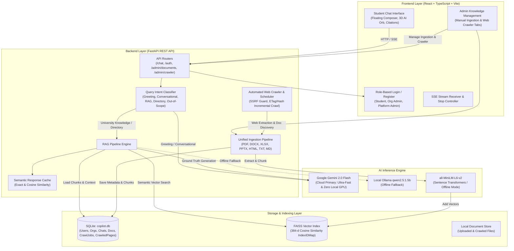
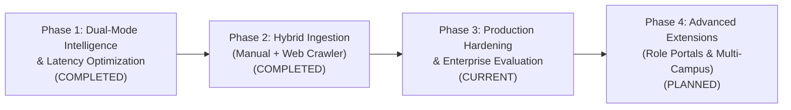

# VIT-AP AI Copilot: Enterprise Knowledge Assistance Platform
## Project Progress Report, Architecture Overview & Execution Plan

> **Date:** November 2026  
> **Branch:** `dheeru-v1`  
> **Repository:** `AI-Powered-Enterprise-Knowledge-Assistance-Platform`  
> **Prepared for:** Project Team & Stakeholders

---

## Executive Summary

The **VIT-AP AI Copilot** is a production-grade Enterprise Knowledge Assistance Platform tailored for university students, faculty, and administrative staff. It provides high-accuracy, conversational, and grounded question-answering over official academic regulations, multi-degree curriculum syllabi, hostel rules, staff contact directories, and official university web resources.

The platform is powered by a **Dual-Mode Hybrid Architecture**:
1. **Conversational Intelligence:** Natural, ultra-fast responses for greetings, introductions, guidance, and university email drafting without unwarranted document-search fallbacks.
2. **Grounded University Knowledge RAG:** Strict document-grounded retrieval and generation over official university PDFs, DOCX, XLSX directories, and crawled web pages with clickable source citations and zero hallucination.

---

## 1. System Architecture Overview



---

## 2. Core Capabilities & Implemented Systems

### A. Dual-Mode Conversational Intelligence & RAG Routing
* **Root Problem Solved:** Previously, the platform treated every incoming message as a strict document search query. Simple greetings ("hello", "good morning") or conversational questions ("who are you", "what can you do") triggered the university fallback error message (*"The requested information is not available in official university documents..."*).
* **Intent Classification Engine (`app/rag/intent.py`):** Automatically categorizes queries into 6 distinct operational intents before FAISS execution:
  1. `GREETING`: Greet warmly, invite university questions (bypasses FAISS, <10ms fast response).
  2. `GENERAL_CONVERSATION`: Introduces system capabilities, explains guidelines, or provides polite replies.
  3. `UNIVERSITY_KNOWLEDGE`: Generates embeddings, retrieves verified syllabus/policy chunks, and applies strict anti-hallucination ground truth prompt constraints.
  4. `STAFF_DIRECTORY`: Scans faculty directories for cabin numbers, employee IDs, titles, and departments.
  5. `OUT_OF_SCOPE`: Politely explains that the Copilot specializes in VIT-AP University affairs and suggests 3 relevant questions the student can ask.
  6. `EMAIL_DRAFTING`: Formats formal, academic email templates addressed to School Deans, Faculty, and Course Coordinators.

---

### B. Complete Hybrid Knowledge Ingestion System

#### Module 1: Manual Multi-Format Document Ingestion
- **Supported Formats:** `PDF`, `DOCX`, `TXT`, `MD`, `CSV`, `XLSX`, `PPTX`, `HTML`.
- **Drag-and-Drop Batch Upload:** Supports multi-file concurrent uploads with category tagging (`Academics`, `Curriculum`, `Hostel Rules`, `Faculty Directory`, `Examinations`, `General`).
- **Extraction & Chunking:** Universal Coordinate-Based Column Extractor splits multi-column curricula without row interleaving; tables are formatted into structured markdown records.
- **Deduplication:** SHA-256 content hashing prevents duplicate files from bloating the FAISS index.
- **Document Lifecycle Management:**
  - **Reprocess:** Cleans stale FAISS vectors and re-indexes source files.
  - **Replace & Versioning:** Uploads new revisions, automatically increments version numbers (`v1.0` $\rightarrow$ `v1.1`), and hot-swaps vector chunks.
  - **Delete:** Full cascading removal across disk storage, SQLite chunk rows, and the FAISS vector index.

#### Module 2: Automated Official Website Crawler
- **Seed URL & Allowlist:** Configured for `https://vitap.ac.in/` with strict subdomain allowlisting (`vitap.ac.in`, `vtop.vitap.ac.in`).
- **Security & SSRF Guardrails:** Validates every URL, resolving DNS and blocking private/loopback/cloud metadata ranges (`127.0.0.0/8`, `10.0.0.0/8`, `172.16.0.0/12`, `192.168.0.0/16`, `169.254.169.254`). Enforces a 25 MB file limit and 15s timeout.
- **Robots.txt & Politeness:** Automatically checks robots.txt compliance and applies configurable rate-limiting delays.
- **Incremental Crawling:** Uses HTTP `ETag`, `If-Modified-Since` (HTTP 304), and SHA-256 hash checks to skip unchanged pages during recurring crawls.
- **Content Extraction:** Trafilatura + BeautifulSoup extractor strips navbars, footers, and scripts, producing clean semantic Markdown.
- **Document Discovery:** Automatically identifies, downloads, and indexes linked PDF handbooks, DOCX files, and spreadsheets.
- **Crawler Controls & Real-Time Logs:** Start, Pause, Resume, and Stop controls with a live monospace streaming log terminal and discovered pages inspection table.
- **Automated Scheduler (`app/services/crawler/scheduler.py`):** Runs daily, weekly, or manual crawls without overlapping runs.

#### Module 3: Knowledge Source Explorer & Semantic Retrieval Inspector
- **Admin Knowledge Origin Breakdown:** Interactive visual breakdown displaying the exact ratio of manual uploaded documents vs. automated web crawler pages, total chunk counts, category distribution, and file type distributions.
- **"Ask & Probe Knowledge" Vector Visualizer:** Live semantic retrieval probe allowing administrators to test any arbitrary question, view matched FAISS chunks, inspection gauges with Cosine Similarity scores (High $\ge 0.70$, Medium $\ge 0.50$, Low $< 0.50$), token/character counts, and exact grounded text excerpts passed to Gemini.
- **Chunk Deep-Dive Inspector Drawer:** Slide-over drawer modal accessible from any document in the system displaying its constituent 384-dimensional semantic chunks, chunk indexes, word counts, character lengths, and JSON metadata.
- **Clickable Citations:** All web-sourced citations in student chat render as clickable hyperlinks opening the real official `vitap.ac.in` page in a new tab with an external link indicator.

#### Module 4: Unified Pipeline
Both manual uploads and crawled pages/PDFs feed into the exact same `IngestionService` ([pipeline.py](file:///c:/Users/dpsin/Desktop/Capstone/backend/app/services/ingestion/pipeline.py)), ensuring 100% unified chunk formatting, metadata attribution, embeddings, and FAISS indexing.

#### Module 5: Grounded Citations & Deep Multi-School Crawl
- **Comprehensive Academic Ingestion:** Over 80+ official university pages and PDFs across all major schools (SCOPE, SENSE, SMEC, VSB, VSL, SAS), Career Development Centre (CDC) placements, hostel fees/curfews, transport routes, and campus life regulations crawled and indexed directly into FAISS (`vitap.index`) and SQLite (`copilot.db`).
- **Next.js RSC Stream Extraction:** Developed a custom parser in `webpage_extractor.py` to extract links and text from Next.js React Server Component (`self.__next_f.push`) payloads used by `vitap.ac.in`.

---

### C. UI/UX SaaS Redesign & 3D Interactive Visuals
- **Interactive Three.js 3D Space & Cyber-Grid Background (`Space3DBackground.tsx`):**
  - High-performance WebGL 3D background featuring hundreds of drifting depth-layered particles in cyber-cyan (`#36D6F5`), electric indigo (`#5577FF`), and violet (`#9875FF`).
  - **Dynamic Interactive Parallax:** Camera gently rotates and tracks cursor movement in real time with spring damping, producing true 3D visual depth behind the chat cards and welcome area.
  - **3D Neural Constellation Strands:** Real-time geometric line connections between drifting particles that dynamically bridge and disconnect as particles float in 3D volume.
  - **Undulating 3D Cyber-Grid Horizon:** A perspective wireframe ground terrain undulating with smooth mathematical sine/cosine ripples at 60fps.
  - Seamlessly layered into both the **Student Chat Interface** (`EmployeeChat.tsx`) and the **Public Landing Page** (`LandingPage.tsx`).
- **Animated 3D AI Holographic Orb (`AI3DOrb.tsx`):** Core holographic wireframe icosahedron with glowing cyan inner core and interactive cursor rotation.
- **3D Card Perspective Depth:** Added 3D perspective transforms (`perspective: 1000px; transform-style: preserve-3d;`) with smooth lift and lighting shimmers on hover for starter prompt cards, AI response bubbles, and admin stat tiles.
- **Premium Floating Chat Composer:** Floating input bar with frosted glassmorphism, responsive mobile layouts, and an abortable SSE streaming stop controller.
- **Sidebar & Dialogue History:** Collapsible conversation history sidebar with active indicator, conversation renaming, and single-click clear functionality.
- **Knowledge Management Portal (`OrgAdmin.tsx`):** Dual-tab interface ("Manual Ingestion" and "Website Crawler") with real-time KPI metrics, upload dropzone, crawler configuration controls, live log terminal, and discovered URL inspector.

---

## 3. Real-World Bugs Resolved

| # | Bug / Issue Discovered | Root Cause | Engineering Resolution |
| :--- | :--- | :--- | :--- |
| **1** | **Two-Column Table Interleaving** | PDFs format courses in two columns; naive extractors read horizontally, merging Left Row 1 with Right Row 1. | Implemented coordinate-based splitting (`x = 295`) in `extractor.py`, isolating columns and locking course codes to their titles. |
| **2** | **Cross-Document Curriculum Bleed** | Vector search pulled chunks from both CSE Core and CSBS into the same prompt context. | Added degree and branch-aware metadata filtering in `retriever.py`. |
| **3** | **Conversational Fallback Error** | The system treated greetings ("hello") as missing document queries, responding with the strict fallback disclaimer. | Built pre-retrieval Query Intent Classification (`QueryIntent.GREETING`), bypassing vector search and generating natural responses. |
| **4** | **Blind 250-Word Chunk Fragmentation** | Blind word-count chunking split tables and mixed Program Core and Electives into single chunks. | Implemented cohesive semantic section chunking matching academic syllabus boundaries. |
| **5** | **Conversation History Hallucination** | Prior inaccurate assistant dialogue turns were echoed back into the LLM context. | Added Ground Truth Authority Rules ensuring context chunks take 100% precedence over previous turns. |
| **6** | **Missing PPTX & HTML Support** | University guidelines and crawled pages in HTML or slide formats failed ingestion. | Built native `extract_text_from_pptx` and `extract_text_from_html` in `extractor.py`. |
| **7** | **Offline HuggingFace Network Lag** | `SentenceTransformer` attempted HEAD requests to Hugging Face Hub, causing timeouts in offline sandbox. | Configured `HF_HUB_OFFLINE=1` and `TRANSFORMERS_OFFLINE=1` in `embedder.py` for instant local model loading. |

---

## 4. Prioritized Execution Plan & Milestone Roadmap



### Phase 1: Dual-Mode Conversational Intelligence *(COMPLETED)*
- [x] Query Intent Classification (`GREETING`, `GENERAL_CONVERSATION`, `UNIVERSITY_KNOWLEDGE`, `STAFF_DIRECTORY`, `OUT_OF_SCOPE`).
- [x] Sub-10ms fast response bypass for greetings.
- [x] Google Gemini 2.0 Flash primary cloud engine with streaming tokens.
- [x] Offline fallback to local Ollama (`qwen2.5:1.5b`).
- [x] Exact and semantic response caching (<70ms cache hit).

### Phase 2: Hybrid Knowledge Ingestion & Web Crawler *(COMPLETED)*
- [x] Multi-format manual document ingestion (PDF, DOCX, XLSX, CSV, PPTX, HTML, TXT, MD).
- [x] Automated website crawler targeting `https://vitap.ac.in/` with robots.txt compliance and rate limiting.
- [x] SSRF guardrails and domain allowlisting.
- [x] Incremental crawling via ETag, HTTP 304, and SHA-256 content deduplication.
- [x] Automatic PDF and document discovery from crawled web pages.
- [x] Unified `IngestionService` feeding the shared chunking, embedding, and FAISS indexing pipeline.
- [x] Document lifecycle: Reprocess, Replace with versioning, and Delete.
- [x] Admin UI in `OrgAdmin.tsx` with live log terminal, crawler controls, and discovered URL inspector.
- [x] Clickable web citations in RAG answers.

### Phase 3: Production Hardening & Verification *(COMPLETED)*
- [x] Unit test suite for hybrid ingestion (`test_hybrid_ingestion.py` — 4/4 passing).
- [x] Unit test suite for intent classification and routing (`test_intent_and_routing.py` — 9/9 passing).
- [x] Unit test suite for core backend APIs (`test_backend.py` — 6/6 passing).
- [x] TypeScript frontend build validation (`0 errors`).
- [x] End-to-end multi-school and academic deep crawl (80+ pages & PDFs across SCOPE, SENSE, SMEC, VSB, VSL, SAS, CDC, Hostels).
- [x] Knowledge Source Explorer & Live Semantic Retrieval Inspector (Admin Tab, Origin Ratio, Probe Gauges, Chunk Deep-Dive Drawer).
- [x] Automated daily backup script for `copilot.db` and the FAISS index files (`backend/backup.py` snapshot creation & restore utility).

### Phase 4: Future Roadmap & Advanced Extensions *(POST-CAPSTONE)*
- [ ] **Interactive Visual Faculty Cards:** Rich interactive UI cards displaying faculty photo, cabin map, and email contact buttons.
- [ ] **Multi-Campus Support:** Extend configuration profiles to support multiple VIT campuses (VIT Vellore, Chennai, Bhopal).
- [ ] **Fine-Grained Role Portals:** Tailored document visibility layers separating student-facing vs. internal faculty circulars.

---

## 5. How to Run & Test the Application

### Prerequisites
* **Python 3.10+** (with virtual environment in `backend/venv`)
* **Node.js 18+** (for frontend)
* **Google Gemini API Key** (set in `backend/.env` as `GEMINI_API_KEY`)
* **Ollama** (optional local fallback)

### Quick Start Commands

#### 1. Backend (FastAPI)
```powershell
cd "backend"
.\venv\Scripts\Activate.ps1
uvicorn app.main:app --host 0.0.0.0 --port 8000 --reload
```
* Interactive API Documentation (Swagger): `http://localhost:8000/docs`

#### 2. Frontend (React + Vite)
```powershell
cd "frontend"
npm run dev -- --host 0.0.0.0 --port 5173
```
* Web Application: `http://localhost:5173`

#### 3. Running Unit Tests
```powershell
cd "backend"
.\venv\Scripts\python.exe -m unittest tests/test_hybrid_ingestion.py
.\venv\Scripts\python.exe -m unittest tests/test_intent_and_routing.py
.\venv\Scripts\python.exe -m unittest tests/test_backend.py
```

#### 4. Default Demo Accounts
* **Student:** `student@vitap.ac.in` / `student123`
* **Org Admin:** `org@vitap.ac.in` / `org123`
* **Platform Admin:** `admin@vitap.ac.in` / `admin123`
