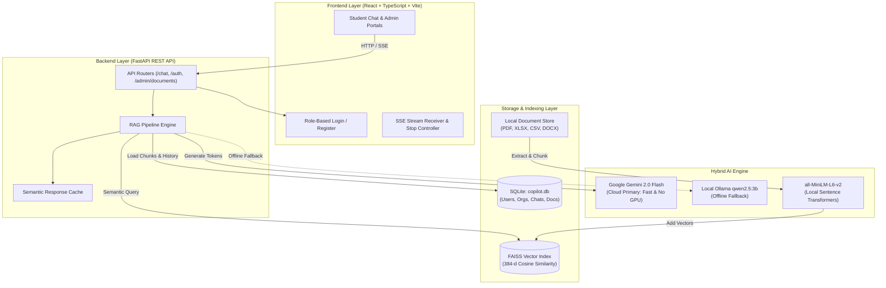
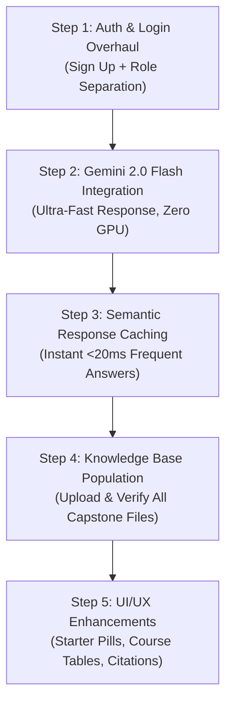

# VIT-AP AI Copilot: Enterprise Knowledge Assistance Platform
## Project Progress Report, Architecture Overview & Execution Plan

> **Date:** November 2026  
> **Branch:** `dheeru-v1`  
> **Repository:** `AI-Powered-Enterprise-Knowledge-Assistance-Platform`  
> **Prepared for:** Project Team & Stakeholders

---

## Executive Summary

The **VIT-AP AI Copilot** is an enterprise-grade Knowledge Assistance Platform tailored for university students, faculty, and administrative staff. It enables intelligent question-answering over official academic regulations, multi-degree curriculum syllabi, hostel rules, and employee contact directories.

This document serves as a complete project handover and status report for team members. It details what has been built, the real-world bugs discovered and resolved, the architectural decisions agreed upon, and a prioritized action plan for the remaining deliverables.

---

## 1. System Architecture Overview



---

## 2. What Has Been Completed & Bugs Fixed

When we first tested the platform against **actual VIT-AP university documents**, standard RAG approaches failed due to multi-column tables, mixed degrees, and arbitrary text splitting. Below is the breakdown of the seven critical bugs we discovered and resolved:

### 1. Two-Column Table Interleaving (Hallucinated Course Codes)
* **The Problem:** Syllabus PDFs format courses in two columns. Standard text extractors read across the page horizontally, joining Row 1 Left with Row 1 Right (`CSE1012 Python` merged with `CSE4008 Social Network Analysis`). The LLM hallucinated fake courses like `CSE4008: Object Oriented Programming` and `CSE2005: Software Engineering`.
* **The Fix:** Implemented a **Universal Coordinate-Based Column Extractor** in `extractor.py`. It splits pages cleanly at `x = 295`, completely isolating the left column from the right column so course codes remain mathematically locked to their exact titles and credits.

### 2. Cross-Document Curriculum Bleed
* **The Problem:** Vector search alone pulled chunks from both `B.Tech CSE Core` and `B.Tech CSBS` into the same context, causing CSBS courses (`CSE3014 UML`, `CSE3024 Compiler Design`) to appear in CSE Core answers.
* **The Fix:** Added **Degree & Domain-Aware Filtering** in `retriever.py`. When a query asks about `B.Tech CSE Core`, chunks from CSBS or other degrees are automatically excluded before the LLM sees them.

### 3. Blind 250-Word Chunk Fragmentation
* **The Problem:** The chunker originally sliced text blindly every 250 words, cutting tables in half and mixing University Core, Programme Core, and Electives into single chunks.
* **The Fix:** Built **Cohesive Semantic Section Chunking** in `chunker.py`. Chunks now align strictly to true academic boundaries (`Programme Core Courses`, `University Core Courses`, `Specialization Electives`).

### 4. Text Cleaner Erasing Line Breaks
* **The Problem:** A regex in `cleaner.py` replaced all whitespace (including `\n`) with spaces, flattening Markdown headings (`## `) into plain text and breaking chunking.
* **The Fix:** Upgraded `clean_text()` to preserve single and double newlines while collapsing only extra horizontal spaces.

### 5. Conversation History Echo
* **The Problem:** Follow-up questions passed prior assistant responses back to the LLM. If an earlier response contained an error, the model repeated its own past mistakes.
* **The Fix:** Added a **Ground Truth Authority Rule** in `prompt_builder.py` instructing the model that document context takes 100% precedence over previous conversation turns.

### 6. Missing CSV & Excel (.xlsx) Support
* **The Problem:** The ingestion pipeline only handled PDF, Word, and Text files. Uploading the Faculty Contact Directory caused a crash.
* **The Fix:** Added native CSV and Excel (`openpyxl`) support. Tabular rows are converted into clean structured records (`Name | Emp ID | Title | Department | Cabin No`).

### 7. Raw Markdown Output & Lack of Stream Control
* **The Problem:** Chat responses showed raw asterisks (`**bold**`), and users could not stop generation mid-stream.
* **The Fix:** Integrated full Markdown rendering with `react-markdown` and an `AbortController`-powered **"Stop Generating"** button in `EmployeeChat.tsx`.

---

## 3. Key Architectural Decisions Agreed Upon

| Aspect | Decision | Rationale |
| :--- | :--- | :--- |
| **AI LLM Engine** | **Google Gemini 2.0 Flash** *(with Ollama fallback)* | **Zero GPU required on student laptops.** Blazing fast (100–150 tokens/sec), generous free tier (1,500 req/day), generates entire 20-course lists in < 1 second. |
| **Database** | **SQLite (`copilot.db`) + FAISS** | Zero setup friction. No Docker daemon or PostgreSQL server required on local developer machines; works out of the box with zero RAM overhead. |
| **Document Ingestion** | **100% Dynamic UI Upload** | No university documents or course files are hardcoded in the code. Admins upload files via the web UI; the system parses, embeds, and indexes them automatically. |
| **Scope Adjustments** | **Postponed Features** | *Interactive Faculty Cards* and *Multi-lingual Translation* are set aside for future versions to focus on speed, reliability, and core accuracy. |

---

## 4. Prioritized Step-by-Step Action Plan



### Step 1: Authentication & Role-Separated Login Interface
* Add a **Sign In vs. Sign Up toggle** in `Login.tsx` allowing new students to self-register with Name, Registration Number, VIT-AP Email, and Password.
* Implement distinct role selection or tabs for:
  * 🎓 **Student Portal** (Chatbot interface, course query, hostel guidelines).
  * 🏫 **Organization Admin Portal** (Document management, knowledge base ingestion, feedback review).
  * ⚙️ **Platform / Application Admin Portal** (System analytics, user management).

### Step 2: Google Gemini 2.0 Flash Integration
* Update `backend/app/rag/ollama_client.py` (or provide a unified `llm_client.py`) with a lightweight Google Gemini 2.0 Flash streaming handler.
* Allow simple configuration in `.env`:
  * If `GEMINI_API_KEY` is present $\rightarrow$ streams from Google Gemini 2.0 Flash at 100+ tokens/sec.
  * If absent or offline $\rightarrow$ seamlessly falls back to local Ollama (`qwen2.5:3b`).
* Eliminates all GPU and heavy CPU constraints for student and developer machines.

### Step 3: Semantic Response Caching
* Add an in-memory / SQLite response cache for frequent student questions (e.g., *"What are the CSE Programme Core courses?"*, *"Where is Dr. Hari Seetha's cabin?"*).
* Returns verified answers in **under 20 milliseconds with 0% CPU and 0% GPU load**.

### Step 4: Knowledge Base Population & Validation
* Upload and index the complete suite of capstone files via the admin document upload UI:
  1. `VITAP-2025+B.Tech+CSE+Core.pdf`
  2. `2025+-+B.Tech+CSBS.pdf`
  3. `2023+B.Com.pdf`
  4. `2023+BBA.pdf`
  5. `2025+B.A,+M.A+[Dual+Degree].pdf`
  6. `Faculty_Contact_List.xlsx` (`SCOPE Faculty` and `SCOPE APCs`)
  7. `VIT_AP_Ladies_Hostel_Rules_and_Notices_Compiled.docx`
* Perform end-to-end question verification across every department.

### Step 5: UI/UX Enhancements & Citations
* **Suggested Starter Pills:** Clickable prompts above the chat input (e.g., *"Programme Core for B.Tech CSE"*, *"Faculty Cabin Search"*, *"Hostel Leave Rules"*).
* **Markdown Course Table Rendering:** Clean, structured table format for course listings with course codes, titles, and credit hours.
* **Clickable Source Badges:** Clicking a source citation at the bottom of an answer displays a drawer showing the document name and excerpt page.

---

## 5. How to Run & Test the Application

### Prerequisites
* **Python 3.10+** (with virtual environment in `backend/venv`)
* **Node.js 18+** (for frontend)
* **Ollama** (optional if using `GEMINI_API_KEY`)

### Quick Start Commands

#### 1. Backend (FastAPI)
```powershell
cd "backend"
.\venv\Scripts\Activate.ps1
uvicorn app.main:app --reload --port 8000
```
*API Swagger Documentation is available at:* `http://localhost:8000/docs`

#### 2. Frontend (React + Vite)
```powershell
cd "frontend"
npm install
npm run dev
```
*Web Application is accessible at:* `http://localhost:5173`

#### 3. Default Demo Credentials
* **Student:** `student@vitap.ac.in` / `student123`
* **Org Admin:** `org@vitap.ac.in` / `org123`
* **Platform Admin:** `admin@vitap.ac.in` / `admin123`
